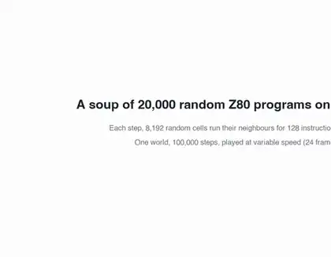

<p align="center">
  
</p>

<h1 align="center">Zilion</h1>

<p align="center"><b>Watch replication begin.</b><br />
A laboratory for the origin of evolution, built from real processors and run on your GPU.</p>

<p align="center"></p>
<p align="center"><sub>One soup of 20,000 random Z80 programs on a 160 × 125 grid, rendered by
<a href="https://github.com/NeoVand/algocell">Algocell</a> at four moments. The first self-copier, the word <code>01 c5</code>
repeated, spreads as a wave; then comes an open phase of damaged copies; finally a descendant whose execution returns
into its own code takes over.</sub></p>

<p align="center">
  <a href="#see-it-in-a-minute">Try it</a> ·
  <a href="#what-you-can-do-with-it">What it does</a> ·
  <a href="#tutorial-your-first-experiments">Tutorial</a> ·
  <a href="#what-has-been-found-with-it">Findings</a> ·
  <a href="#how-far-can-you-trust-it">Validation</a> ·
  <a href="#citing-zilion">Cite</a>
</p>

---

Put a few thousand random strings of machine code in a dish. Let neighbours meet: join two programs end to end, run
them for a moment on a real processor, and keep whatever they wrote. Nobody sets a goal and nothing is rewarded. Within
minutes, a program that copies itself appears out of the noise and sweeps the dish.

This happens reliably, it can be repeated thousands of times, and every byte of every copy can be recorded. That turns
these *primordial soups* of code into an experimental system for questions that are very hard to ask of chemistry. How
does replication begin? When does copying start to pass on differences, so that evolution can act on them? What changes
when the chemistry changes?

**Zilion is the instrument for those experiments.** It emulates real processors (the Zilog Z80, the MOS 6502 and the
Intel 8086) and a minimal tape language (BFF), runs about a billion instructions per second on an ordinary laptop GPU,
and records exactly what each encounter read, executed and wrote. The rules of the world, such as memory layout,
starting state, time budget and what counts as death, are written down separately from the processor. The same world
can therefore be run under different "chemistries" and compared.

It is built for researchers in the origins of life, evolutionary biology, astrobiology and artificial life who want a
controllable system in which self-replication emerges by itself and can be taken apart, one byte at a time.

## See it in a minute

For the full interactive experience, open [Algocell](https://neovand.github.io/algocell/), a live soup in the browser
built on Zilion. To see how little code a soup needs, [`examples/soup.html`](examples/soup.html) is a complete one in
about 250 lines. 4,096 random 16-byte
programs sit on a 64 × 64 grid. In each update about 1,600 neighbouring pairs meet; each pair is joined into one 32-byte
ring and executed for 128 steps on an emulated Z80, then split back, and a few random bytes mutate. Colours identify
programs, so when one colour spreads, one program is copying itself.

```sh
git clone https://github.com/NeoVand/zilion.git
cd zilion
npm ci && npm run build
python3 -m http.server 8000
# open http://localhost:8000/examples/soup.html in a WebGPU browser (recent Chrome, Edge or Safari)
```

On a laptop the soup first fills with zero bytes, a kind of inert order that spreads without being inherited. Then,
usually within a minute or so, a self-copier takes over. Its most common form is the tape `01 c5 01 c5 …`: the processor reads `01 c5 01` as "load the
next two bytes into register pair BC" and `c5` as "push BC into memory", so the program writes its own bytes into its
neighbour. The page's built-in test runs the most common tape against 16 random partners and reports how often the
partner becomes a copy. Switch the chemistry to *lethal*, where executing a zero byte is fatal, and watch a different
history unfold. Add `?seed=42` to the address to repeat a run exactly.

## What you can do with it

**Grow replicators from noise.** No designed ancestor is needed. Random code, random meetings and mutation are enough,
and you can watch the first self-copier arise, spread as a wave across the grid and give way to successors.

**Change the chemistry.** The same world can run on four instruction sets, each a different vocabulary in which some
things are easy to say and others hard. The Z80 (ZX Spectrum, Pac-Man) has two-byte pushes and block-copy
instructions. The 6502 (Apple II, Commodore 64, NES) pushes one byte at a time. The 8086 (the original IBM PC family)
has segmented memory and repeated string moves. BFF is the minimal tape language of Agüera y Arcas and colleagues.
Whether a finding holds across vocabularies tells you whether it is about replication or about one machine.

**Change the physics.** Make a byte value lethal when executed, or make it halt with a chosen probability. Forbid whole
families of instructions to ask which ones replication needs. Change tape length, ring size, the time budget per
meeting, and whether registers start at zero or at random.

**See inside every encounter.** For each meeting, Zilion can return which bytes were executed as instructions, where
instructions started, how many bytes were written into each program, the final registers and why execution stopped. That
lets you tell a program that stays inside its own tape (*confined*) from one whose execution runs into its partner
(*open*), and ask whose bytes ended up where.

**Run controlled experiments.** Lift a program out of the soup and culture it against fresh random partners. Plant a
marker byte in a parent and follow it through generations, separately from the survival of the lineage. Every random
draw is seeded, so experiments repeat exactly.

**Scale up and publish.** Export any machine as a WGSL compute shader plus a JSON manifest, and run it from Python
(`wgpu-py`) on cloud GPUs. Manifests carry SHA-256 identities of the core, the world and the shader, and semantic
versions are frozen, so a paper can state exactly what was run and anyone can rerun it.

## Tutorial: your first experiments

Each step is a few lines of JavaScript. Run them in a page served as in [See it in a minute](#see-it-in-a-minute), or in
any app that bundles npm packages:

```sh
npm install @neovand/zilion
```

### 1. One meeting between two programs

A *world* describes where programs meet. Here two tapes, A and B, of 16 bytes each sit back to back on a 32-byte ring.
The processor starts with every register at zero, the stack pointer aliases the last byte of B, and execution starts at
A's first byte and runs for 128 steps.

```js
import { createEngine, z80 } from "@neovand/zilion"; // or "./dist/index.js" from a checkout

const world = {
  memory: { kind: "segments", segments: [{ bytes: 16, name: "A" }, { bytes: 16, name: "B" }] },
  init: { stack: { topAliases: "lastByte" } }, // registers start at zero; SP aliases B's last byte
  budget: { unit: "steps", value: 128 },
  outputs: { memory: true, fetchMap: true },
};

const engine = await createEngine();
const machine = await engine.machine({ core: { isa: z80, compat: "0.3" }, world });

const hex = (bytes) => Array.from(bytes, (v) => v.toString(16).padStart(2, "0")).join(" ");
const pusher = Array(8).fill([0x01, 0xc5]).flat(); // 01 c5 01 c5 …
const partner = Array.from({ length: 16 }, () => Math.floor(Math.random() * 256));

const result = await machine.run([[...pusher, ...partner]]); // one lane; pass many to run them in parallel
console.log(hex(result.memoryOf(0).subarray(16))); // B afterwards: 01 c5 01 c5 01 c5 …
```

The partner has been overwritten with a copy of the pusher. `machine.run` takes one memory image per lane and runs all of
them at once on the GPU; a soup simply passes thousands of pairs per call.

### 2. Open or confined?

The fetch map lists every ring position the processor read as an instruction. Positions 16–31 belong to B.

```js
const open = result.fetchedOf(0).some((position) => position >= 16);
console.log(open); // true: the pusher's execution runs on into its partner
```

### 3. One byte decides what is inherited

Many evolved Z80 copiers share a four-byte core, `XX 5e ed b0`. With every register at zero, `5e` loads the value of
the tape's own first byte into register E, and `ed b0` (`LDIR`) copies memory forwards, writing each byte that many
positions ahead of where it read it. The first byte is therefore both a harmless instruction and the *copy distance*.
Give two copiers the same marker payload and different first bytes:

```js
const marker = Array(12).fill(0xaa);
const both = await machine.run([
  [0x50, 0x5e, 0xed, 0xb0, ...marker, ...partner], // distance 0x50 mod 32 = 16: the whole tape
  [0x04, 0x5e, 0xed, 0xb0, ...marker, ...partner], // distance 4: only the core
]);
console.log(hex(both.memoryOf(0).subarray(16))); // 50 5e ed b0 aa aa aa …  marker inherited
console.log(hex(both.memoryOf(1).subarray(16))); // 04 5e ed b0 04 5e ed b0 …  marker erased
console.log(both.fetchedOf(0), both.fetchedOf(1)); // [0, 1, 2, 3] twice: both are confined
```

Both copiers are confined and both reproduce, but only one passes on the marker. When the copy distance d divides the
tape length, the number of positions free to carry anything is d minus the core's length, and the distance byte is
itself copied to the offspring. That is the central observation of the paper described [below](#what-has-been-found-with-it).

### 4. Change the chemistry, change the physics

Worlds take conditions. Build one machine per condition, keep everything else identical, and compare.

```js
// Lethal chemistry: executing a zero byte kills the run (add `probability: 0.3` for a dial).
const lethal = await engine.machine({
  core: { isa: z80, compat: "0.3" },
  world: { ...world, halting: { lethal: { firstUnit: 0 } } },
});

// Ablation: forbid every PUSH of a register pair (opcodes c5, d5, e5, f5) by turning it into a no-op.
const noPush = await engine.machine({
  core: { isa: z80, compat: "0.3" },
  world: { ...world, ablation: { expr: "prefix == 0u && (op & 0xcfu) == 0xc5u" } },
});
const blocked = await noPush.run([[...pusher, ...partner]]);
console.log(hex(blocked.memoryOf(0).subarray(16))); // the partner is untouched: no pushes, no copy
```

Ablation expressions see the decoded prefix and opcode, so you can remove a single instruction, a family or a whole
prefix page. A packed per-page table (`ablation: { table: "uniform" }`) changes the forbidden set between runs without
recompiling.

### 5. Another processor

Swap the core and keep the world. `firstPushAt` puts the first pushed byte at the same ring position on every
instruction set, which keeps cross-chemistry comparisons fair.

```js
import { m6502, i8086 } from "@neovand/zilion";

const crossWorld = { ...world, init: { stack: { firstPushAt: "lastByte" } } };
const mos = await engine.machine({ core: { isa: m6502, compat: "0.3" }, world: crossWorld });
const intel = await engine.machine({ core: { isa: i8086, compat: "0.3" }, world: crossWorld });
```

The 8086 core models instruction semantics with coherent fetch. Read [I8086](docs/I8086.md) before designing 8086
worlds; the paper's 8086 soups, for example, started the stack pointer at 1 rather than using `firstPushAt`.

### 6. A soup

A soup is a loop around `machine.run`. Each update: draw cells, pair each with a random neighbour, copy both tapes into
one lane, run every lane at once, write the two halves back, then mutate a few random bytes. That is the whole of
[`examples/soup.html`](examples/soup.html). Population structure, sampling and measurement live in your code, so they
stay visible and under your control.

### 7. From Python, at scale

The research runs behind the paper used Python on cloud GPUs. Export any machine as a WGSL shader plus a manifest and
run it with [`wgpu-py`](https://github.com/pygfx/wgpu-py):

```sh
node scripts/export-machines.mjs --list-cores
node scripts/export-machines.mjs machines.json --out build/exported
```

`machines.json` is a list of `{ "name", "core": { "isa", "compat" }, "world" }` objects, in the same form as above with
the instruction set named by id. The manifest records buffer layouts, parameters and SHA-256 identities.

## What has been found with it

Zilion was built for a study of what spontaneous replicators pass on to their descendants. The paper is in
preparation; in short:

- **Reproduction is not heredity.** The first replicator in Z80 soups, the `01 c5` pusher, sustains its lineages while
  losing every one of 512 tested variants by a registered carriage criterion. It rebuilds its pattern and forgets what
  was done to it.
- **One inherited byte sets how much is inherited.** For the recurring forward-copy family above, the number of freely
  inherited positions is the copy distance minus the core's length. Registered edits of that byte in Z80 copiers, across
  1,067,608 tests, and 42 eligible evolved 6502 copiers matched this prediction without a single mismatch.
- **The environment chooses.** Making the zero byte lethal shifts populations from copiers that erase variation towards
  copiers that keep it.
- **Availability does not predict evolution.** The 8086 can run a pusher just like the Z80's, yet its soups mostly began
  with confined copiers, a registered prediction that failed. Many of them independently evolved the same
  four-byte-distance copying geometry as the Z80.

## Key ideas, in plain words

| Term | Meaning |
|---|---|
| Tape | A program: a short string of bytes, each one an instruction or data. |
| Encounter | Two tapes joined into one ring of memory and executed together for a fixed budget. |
| Ring | Memory whose end wraps around to its start, so a program can run or write into its partner. |
| Budget | Instruction steps allowed per encounter; a world never runs on a hidden default. |
| Reset state | What registers and the stack hold when an encounter starts. Evolved copiers can depend on it. |
| Open / confined | Whether execution runs into the partner's bytes, or stays inside the program's own tape. |
| Fetch map | The positions read as instructions during an encounter; the basis of open versus confined. |
| Chemistry | The instruction set, plus world rules such as which byte values are lethal. |
| Ablation | Turning chosen instructions into no-ops, to ask which ones replication needs. |

## How far can you trust it?

An emulator is a measuring instrument, so it is checked like one: instruction by instruction, against independent
reference tests, with every expected difference stated in advance and tested with deliberately planted faults. These are
instruction and state checks, not cycle-timing claims.

| Core | Reference tests | Unexpected differences | Report |
|---|---:|---:|---|
| Z80, compat 0.3 (classic and `zilog-nmos`) | 1,604,470 each | 0 | [Classic](test/baselines/z80-v0.3.0-dev.md), [NMOS](test/baselines/z80-v0.3.0-dev-zilog-nmos.md) |
| Z80, compat 0.2 (frozen) | 1,604,384 | 0 | [Frozen baseline](test/baselines/z80-v0.2.0.md) |
| NMOS 6502 | 2,560,000 | 0 | [6502 baseline](test/baselines/6502-v0.3.0-dev.md) |
| 8086, coherent fetch | 3,137,000 recorded from real hardware | 0 | [Architectural baseline](test/baselines/8086-architectural.md) |
| BFF | 20,971,520 GPU pair comparisons | 0 | [Equivalence](test/baselines/bff-equivalence.md) |

The Z80 and 6502 references are the community SingleStepTests suites; the 8086 references were recorded from a physical
8088. "Zero unexpected differences" does not mean zero raw differences: each report lists its narrowly scoped expected
rules, such as 10,083 8086 cases that depend on a hidden internal latch the hardware recordings do not capture. The
ledgers were recorded at version `0.3.0-dev`, whose instruction semantics are those of the 0.3.x releases.

A Z80 machine must name its semantics explicitly. `compat: "0.2"` is frozen byte for byte, so historical experiments
remain reproducible; `compat: "0.3"` corrects rarely used corners (refresh counting after wasted prefixes, the hidden
WZ/MEMPTR register, interrupt mode and block-repeat flags), and the `zilog-nmos` variant adds the Q latch of NMOS chips.
To reproduce every ledger, fetch the pinned datasets and run the suites in [Testing](docs/TESTING.md).

## Speed

On an Apple M4 laptop GPU, with 262,144 random 32-byte pair rings and a 128-step budget, Zilion executes about 1.09
billion Z80 steps, 0.86 billion 6502 steps and 0.33 billion 8086 steps per second
([measurements and method](test/baselines/8086-throughput.md)). The example soup runs roughly 150 updates per second in
a browser, most of it spent moving data between the CPU and the GPU.

## Limits worth knowing

- Zilion emulates instruction semantics, not whole computers: no cycle timing, no external interrupts and no peripherals.
  Budgets count instruction steps or instruction-stream bytes.
- The 8086 core reads each instruction from current memory (*coherent fetch*), without the real chip's prefetch queue.
  Self-modifying code therefore behaves differently from a physical 8088, and experiments must say so.
- The 6502 is the NMOS chip only. BFF ships in the source and exporter but not yet in the npm interface.
- Each lane has private memory. Populations, pairing and mutation are written by the host, as in the example soup.
- GPU validation was measured on Apple M4 (Metal). Bit identity across other GPU backends has not yet been measured.

## For developers

An **IsaCore** is WGSL plus a descriptor of state fields, a step function, address and fetch widths, decode pages,
hooks, stack and entry conventions, traps and named semantics. A **world** defines memory (power-of-two, any-size ring
or named segments), initialization, budget, halting and trap policies, ablation and outputs. `buildMachine` turns a core
and a world into WGSL and a `zilion.manifest/2` manifest; `createEngine` runs machines in a browser or any host with a
`GPUDevice`, chunking large batches to device limits and keeping resident batches on the GPU when asked. The 0.2 API
(`Zilion`, `buildComputeShader`) remains available with frozen semantics.

Read [Architecture](docs/ARCHITECTURE.md) for the full contract, [Adding a core](docs/ADDING_A_CORE.md) to bring a new
instruction set, [Testing](docs/TESTING.md) to reproduce the validation, and the [CHANGELOG](CHANGELOG.md) for release
history. Zilion has no JavaScript runtime dependencies.

## Citing Zilion

The paper introducing Zilion is in preparation. Until it appears, cite the software and the exact version you used;
[CITATION.cff](CITATION.cff) has machine-readable metadata.

> Mostafa 'Neo' Mohsenvand (MIT Media Lab). *Zilion: a multi-ISA WebGPU batch emulator*. https://github.com/NeoVand/zilion

Zilion grew out of [Algocell](https://github.com/NeoVand/algocell), a live soup in the browser. It owes its central
inspiration to *Computational Life* by Agüera y Arcas and colleagues ([arXiv:2406.19108](https://arxiv.org/abs/2406.19108)),
which showed that self-replicators arise from random programs, and to the SingleStepTests project, whose reference
suites make careful emulation possible. Zilion is [MIT licensed](LICENSE); validation datasets are downloaded separately
under their own licences ([third-party attribution](THIRD_PARTY.md)).
