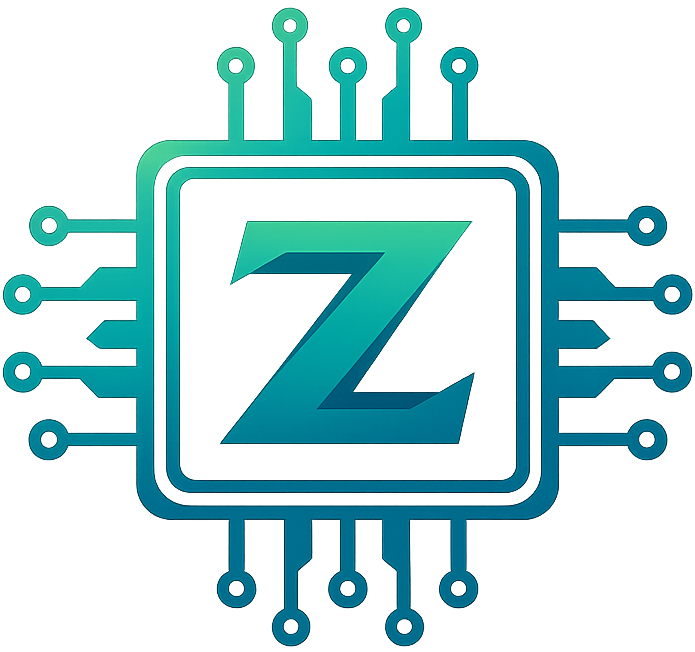

<p align="center">
  
</p>

<h1 align="center">Zilion</h1>

<p align="center">
  <b>A zillion Z80s in parallel, on your GPU.</b><br/>
  A WebGPU-accelerated, differentially-tested Zilog Z80 emulator for massively parallel batch execution.
</p>

<p align="center">
  <a href="https://www.npmjs.com/package/@neovand/zilion"></a>
  
  
  
</p>

---

Zilion runs **thousands of independent Z80 CPUs at once** as a single WebGPU compute dispatch — one CPU per GPU thread, each with its own private memory. It was born inside an [artificial-life simulator](#origin) that needed to execute tens of millions of tiny Z80 programs per second, so it is built for **scale**: give it a batch of programs, get back their final memory and registers.

```
4,096 Z80 programs · 16 instructions each · ~2.5 ms on a laptop GPU
```

## Why?

CPU emulators run one machine at a time. But a whole class of problems needs to run _many_ small Z80 programs independently and cheaply:

- 🧬 **Artificial life & open-ended evolution** — soups of self-modifying machine code (à la [BFF / Computational Life](https://arxiv.org/abs/2406.19108)).
- 🧠 **Genetic programming** — evaluate an entire population of evolved Z80 programs each generation.
- 🔎 **Search & fuzzing** — brute-force or randomized exploration of program space.
- 🕹️ **Batch retro tooling** — run many short ROM snippets or test vectors in parallel.

Zilion turns "run N Z80s" into one GPU dispatch instead of N CPU loops.

## Highlights

- ⚡ **Massively parallel** — one Z80 per GPU invocation, thousands at a time.
- 🎯 **Correct** — the full documented instruction set plus **IX/IY**, **CB/ED/DDCB/FDCB** prefixes, shadow registers, and undocumented flag behavior, [differential-tested](#correctness) against a real-Z80 reference emulator.
- 🌍 **Worlds** _(0.3, in development)_ — rings of any size (odd, padded), pairs of tapes, budgets, halting dials, fetch maps: one [world spec](#worlds-machines-and-the-engine-03-in-development) that is the same code for every instruction set.
- 🧩 **Simple API** — `create` once, `run` batches, read back memory + registers.
- 🔬 **Instruction ablation** — remove any instruction from the ISA (including prefixed ones like `LDIR`) with a one-line hook; built for instruction-set experiments.
- 🪶 **Zero dependencies**, TypeScript-native, ships as ESM.
- 🔌 **Bring your own `GPUDevice`** or let Zilion request one.

## Install

```bash
npm install @neovand/zilion
```

Requires an environment with [WebGPU](https://caniuse.com/webgpu) (Chrome/Edge 113+, Safari 18+, Firefox 141+, or Node 22+ with a WebGPU backend).

## Quick start

```ts
import { Zilion } from "@neovand/zilion";

const z80 = await Zilion.create({ memBytes: 256 });

// A tiny program: LD A,0x42 ; INC A ; HALT
const program = [0x3e, 0x42, 0x3c, 0x76];

const result = await z80.run([program], { steps: 16 });

console.log((result.registers[0].af >> 8).toString(16)); // "43"
console.log(result.memoryOf(0)); // final 256-byte memory image

z80.destroy();
```

### Running a batch

Every entry in the array is an independent Z80 with its own memory:

```ts
// 10,000 random 32-byte programs, 128 instructions each — one dispatch.
const programs = Array.from({ length: 10_000 }, () =>
  Uint8Array.from({ length: 32 }, () => (Math.random() * 256) | 0),
);

const { registers, memory, memoryOf } = await z80.run(programs, { steps: 128 });
// registers[i], memoryOf(i) → the outcome of program i
```

### Custom starting registers

```ts
await z80.run([program], {
  steps: 64,
  init: [{ af: 0x4100, bc: 0x0008, sp: 0xfff0 }], // A=0x41, BC=8, SP=0xFFF0
});
```

## API

### `Zilion.create(options?)`

```ts
interface ZilionOptions {
  memBytes?: number; // memory per program, power of two (default 256)
  device?: GPUDevice; // provide your own, or Zilion requests one
  fetchHook?: string; // instruction ablation: a WGSL boolean over `prefix` and `op` (see below)
}
```

The Z80's 16-bit address space **wraps** onto `memBytes` (so a program can't escape its instance). Smaller memories mean more programs run concurrently; larger memories reduce GPU occupancy.

### `zilion.run(programs, options)`

```ts
interface RunOptions {
  steps: number; // instructions per program (stops early on HALT)
  init?: Z80RegisterInit[]; // optional per-program starting registers
}

interface RunResult {
  count: number;
  memBytes: number;
  memory: Uint8Array; // flat: count * memBytes
  registers: Z80Registers[]; // af, bc, de, hl, ix, iy, sp, pc, + shadows
  memoryOf(i: number): Uint8Array; // program i's final memory
}
```

Each program is copied into its instance's memory (zero-padded or truncated to `memBytes`). Registers reset to zero except **SP = 0xFFFF** (a real Z80 reset), unless overridden via `init`.

Any number of programs can be passed: since 0.3 a batch is split into chunks that respect the device limits (0.2 failed above 4,194,240 programs or 128 MiB of memory), and an invalid `fetchHook` makes `create` reject with the compiler's message. As in 0.2, each run owns its GPU buffers and releases them before it resolves.

### `zilion.destroy()`

Releases GPU resources (and the device if Zilion created it).

### Instruction ablation (`fetchHook`)

Zilion can remove instructions from the ISA. Pass a WGSL boolean expression over
`prefix` and `op`; every instruction for which it is true is skipped as a NOP:

```ts
// No block copies (LDIR/LDDR/LDI/LDD) and no PUSH:
const z80 = await Zilion.create({
  memBytes: 256,
  fetchHook:
    "(prefix == 0xedu && (op & 0xf7u) == 0xa0u) || (prefix == 0u && (op & 0xcfu) == 0xc5u)",
});
```

The hook fires once per executed instruction, **after prefix resolution**:

| `prefix`            | page                          | `op`                             |
| ------------------- | ----------------------------- | -------------------------------- |
| `0`                 | base                          | the opcode byte                  |
| `0xDD` / `0xFD`     | IX / IY form of a base opcode | the opcode byte after the prefix |
| `0xCB`              | CB (rotates, bits)            | the byte after `CB`              |
| `0xED`              | ED (block ops, 16-bit loads)  | the byte after `ED`              |
| `0xDDCB` / `0xFDCB` | indexed bit ops               | the byte after the displacement  |

Prefix bytes are never reported as `op`. A skipped base-page opcode is a 1-byte
NOP: its operand bytes are _not_ skipped and run as the next instruction, exactly
as if the opcode had been removed from the CPU. Skipped CB/ED-page opcodes are
2-byte NOPs (like undefined `ED` opcodes on real hardware); skipped DDCB/FDCB
opcodes are 4-byte NOPs. `R` increments as for a real fetch.

### Embedding the core in your own shader

`Z80_CORE_WGSL` is the bare core. A host shader declares the memory model and the
hook before splicing it in:

```wgsl
fn mem_read(addr: u32) -> u32 { ... }
fn mem_write(addr: u32, val: u32) { ... }
fn on_fetch_opcode(prefix: u32, op: u32) -> bool { ... }
// ${Z80_CORE_WGSL}
```

then calls `z80_step()` in a loop after initialising the `cpu_*` registers. See
`buildComputeShader` in `src/legacy/shader.ts` for a complete host.

`Z80_CORE_WGSL` is byte-identical to 0.2.0. `z80CoreText(hooks)` adds the opt-in hooks of host contract v2
(`on_fetch`, `on_instruction_start`, `zil_trap`, `io_in`/`io_out`; see [docs/ARCHITECTURE.md](docs/ARCHITECTURE.md))
without moving any line other hosts patch. Rather than writing a host by hand, `buildMachine({ mode: 'library' })`
emits the world as functions (`zil_begin`, `zil_run`, `zil_load_memory`, …) for a shader that owns its buffers.

## Worlds, machines and the engine (0.3, in development)

A **world** says where programs live and how they run: the memory model (a power-of-two mask, a ring of any
size, or segments such as a pair of tapes on a padded ring), the initial state, the budget, halting and trap
policies, instruction ablation and what to record. `buildMachine` turns a core and a world into WGSL and a JSON
**manifest**; the engine runs it.

```ts
import { createEngine, z80 } from "@neovand/zilion";

const engine = await createEngine();
const m = await engine.machine({
  isa: z80,
  world: {
    // tapes A and B (16 bytes each) on a 37-byte ring: 5 bytes of padding, zeroed every run, never stored
    memory: { kind: "segments", segments: [{ bytes: 16, name: "A" }, { bytes: 16, name: "B" }], ring: 37 },
    init: { stack: { firstPushAt: "lastByte" } }, // the first byte pushed lands on the last byte of B (SP0 = 0xFFF2 here)
    budget: { unit: "steps", value: 128 }, // a world always states its budget and (on a CPU with a stack) its stack
    halting: { lethal: { firstUnit: 0x00, probability: 0.03 } }, // a zero opcode halts with p = 0.03
    ablation: { table: "uniform" }, // a bitset per run, no recompile
    outputs: { writeCounts: true, fetchMap: true, startMap: true },
  },
});
const r = await m.run(pairs /* N × 32 bytes */, { seed: 1, ablation: masks });
r.steps[i]; r.haltReasonOf(i); r.trapCauseOf(i); r.stateOf(i).sp; r.writesOf(i); r.fetchedOf(i); r.memoryOf(i);
// continue the same lanes for 64 more steps: the dials draw what one 192-step run would have drawn
const r2 = await m.run(r.memory, { seed: 1, ablation: masks, budget: 64, stepBase: 128, resume: r.record });
```

- **The seam.** The Z80 forms 16-bit addresses and the world maps them to ring positions, so on a ring whose
  size does not divide 65,536 a crossing of address 0 lands at (65536 + t) mod P (`seamOffset`, `ringPos`,
  `highestAlias`).
- **Randomness** is a stateless hash of (seed, lane, step, salt), so results do not depend on how a batch is
  chunked or ordered, nor on how a run is split across dispatches (`stepBase`, `resume`).
- **Core parameters** are compile-time constants a core declares and a machine selects:
  `engine.machine({ core: { isa, params: { … } }, world })`.
- **Batches** of any size; `m.batch(n)` keeps lanes resident on the GPU and encodes into your own command
  encoder.
- **Python and other hosts** read the manifest (bindings, params offsets, memory and record layouts, SHA-256
  provenance); `node scripts/export-machines.mjs worlds.json --out shaders/` writes the WGSL and manifest for
  each named world, and `test/world/gpu_runner.py` is a complete wgpu-py host driven only by the manifest.
- **More than the Z80.** A full NMOS 6502 core (every opcode, validated against 2,560,000 SingleStepTests vectors;
  experimental; `@neovand/zilion/m6502`) and a BFF skeleton run in the same worlds; see
  [docs/ADDING_A_CORE.md](docs/ADDING_A_CORE.md).

The design and its layers are in [docs/ARCHITECTURE.md](docs/ARCHITECTURE.md).

## How it works

Zilion generates a WGSL compute shader containing a complete Z80 core. Each shader invocation:

1. copies its program into a private in-register memory array,
2. resets a fresh CPU,
3. runs the fetch–decode–execute loop for `steps` instructions (or until `HALT`),
4. writes the final memory and registers back to storage buffers.

`workgroup_size = 64`, dispatched over `ceil(count / 64)` workgroups. Because every CPU is independent, this is embarrassingly parallel — the GPU runs as many as it has lanes for.

## Correctness

Emulator bugs hide in undocumented corners, so Zilion's Z80 core was developed against a **real-Z80 oracle** (a Fuse-lineage reference emulator that passes the `zexall`/`zexdoc` conformance suites): in [Algocell](https://github.com/NeoVand/algocell), over a million random programs were run through both the GPU core and the reference at six ring sizes, and their final **memory and registers** compared, with every divergence attributed. That differential harness lives in Algocell; this repository carries known-answer vectors (`test/conformance.js`), a byte-identity check of the core against 0.2.0, and GPU tests of the world semantics (see [Development](#development)). Per-instruction conformance vectors are being added.

The core implements the full documented instruction set, the **CB**, **ED**, **DD/FD (IX/IY)**, and **DDCB/FDCB** prefix pages (including the undocumented DDCB register-copy side effect and the CPI/CPD undocumented-flag quirk), shadow registers, and `EXX`/`EX AF,AF'`.

> **Scope & honesty:** Zilion is a batch execution core, not a cycle-accurate machine emulator. There are no interrupts and no I/O ports (`IN` reads 0, `OUT` is a no-op), and time is counted in instructions, not T-states — every instruction advances the step counter by one. The `R` refresh register increments per M1 (opcode/prefix) fetch and `HALT` idles correctly (re-executing itself until the step budget runs out, matching a real Z80's PC/R behavior). Two documented simplifications in 0.2.0, kept byte for byte by the 0.2 API (`Zilion`, `buildComputeShader`, `Z80_CORE_WGSL`) and by `compat: '0.2'`: the internal `WZ`/`memptr` register isn't modeled, so the _undocumented_ F3/F5 flag bits of `BIT n,(HL)` come from the operand rather than the memory address (this never affects control flow); and a wasted `DD`/`FD` prefix (one followed by `DD`, `FD` or `ED`) adds 2 to `R` instead of 1. The 0.3.0-dev Z80 of `buildMachine` (`compat: '0.3'`, the default) fixes both and also models IM and the block-repeat flags; variant `zilog-nmos` adds the Q latch (see docs/ARCHITECTURE.md, "The Z80 core"). Everything else — the full documented instruction set across the base, CB, ED, and DD/FD/DDCB/FDCB pages — is differential-tested against a real-Z80 reference to zero divergence in documented behavior. If you need cycle-accurate single-machine emulation, use a dedicated emulator; if you need to run a zillion Z80s fast, use Zilion.

## Performance

One dispatch scales with your GPU, not your program count. As a rough sense of scale, a mid-range laptop GPU runs several thousand 16-instruction programs in a couple of milliseconds. For best throughput, keep `memBytes` small and batch as many programs as you can into a single `run`.

## Development

```bash
npm run build
npm run check:bytes    # the 0.2 configuration is byte-identical to the v0.2.0 tag and the published 0.2.0 package
npm run test:unit      # no GPU needed
npm run test:engine    # engine ordering and lifecycle on a mock device (no GPU needed)
ZILION_PYTHON=/path/to/python npm run test:world      # GPU, via wgpu-py + numpy (headless)
ZILION_PYTHON=/path/to/python npm run test:algocell   # against Algocell's exported shaders (needs a checkout)
node scripts/serve.mjs # then open http://127.0.0.1:8937/test/engine.html (engine on browser WebGPU)
```

## Origin

Zilion was extracted from **[Algocell](https://github.com/NeoVand/algocell)**, a WebGPU artificial-life simulator where random bytes evolve into self-replicating Z80 machine code. The differential-testing methodology and the correctness fixes that made this core trustworthy came from that project.

## License

[MIT](LICENSE) © NeoVand
